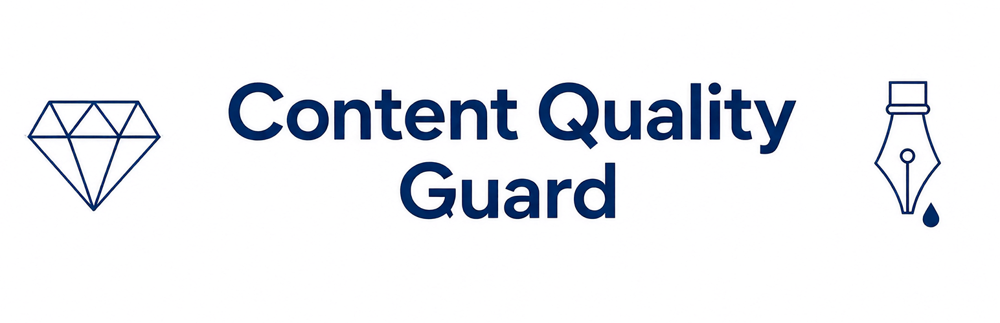
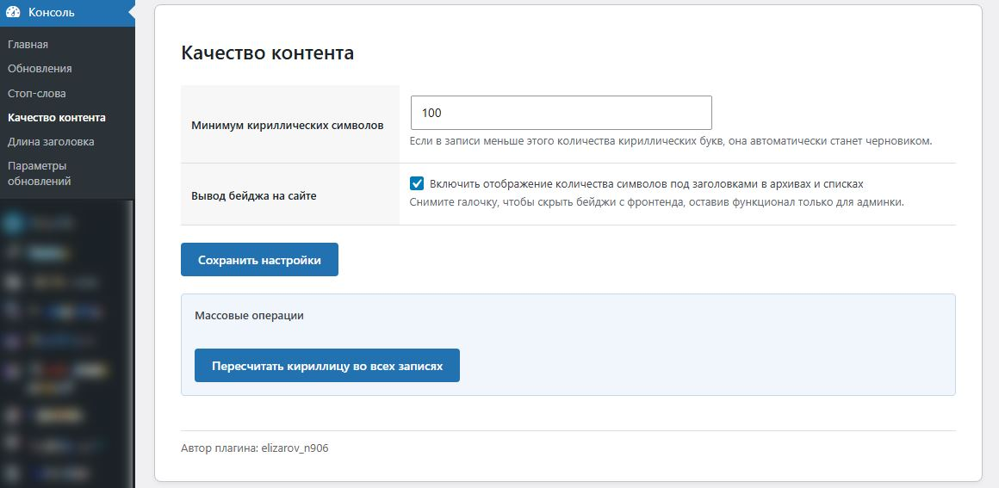
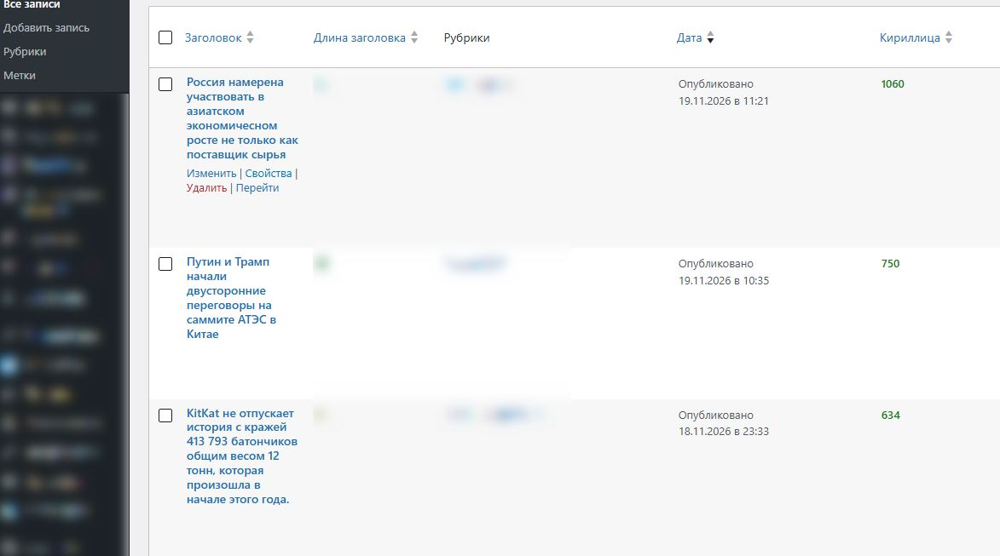
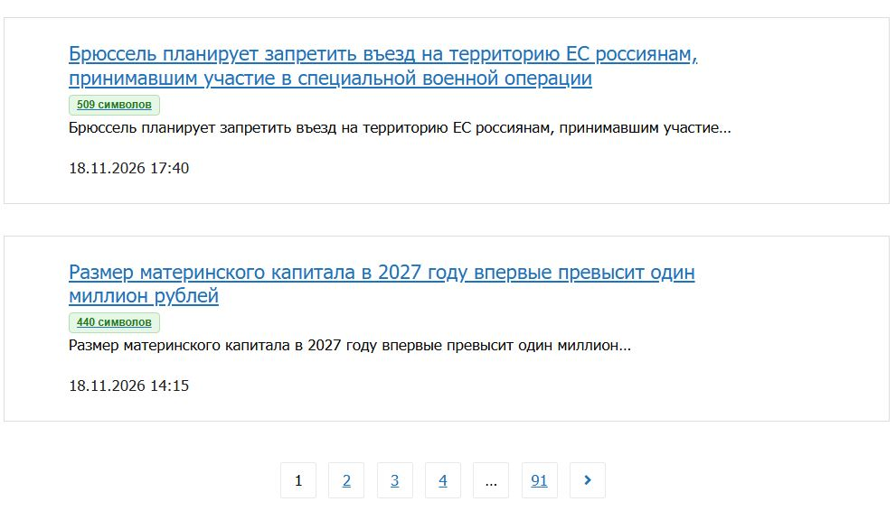

# Content Quality Guard

  

## Автоматический контроль объема кириллицы и защита от пустых постов

**Content Quality Guard** — умный инструмент для поддержания качества контента в WordPress. Плагин подсчитывает количество кириллических символов, автоматически переводит «пустые» записи в черновики и выводит информативные бейджи в архивах сайта.

[Описание](#о-плагине) · [Возможности](#возможности) · [Установка](#установка) · [Использование](#использование) · [Похожие плагины](#похожие-плагины)

---

## О плагине

Часто авторы случайно публикуют записи без текста или с минимальным содержанием. Content Quality Guard решает эту проблему, анализируя контент на лету. Если в записи меньше заданного порога кириллических символов, она не сможет быть опубликована и будет автоматически сохранена как черновик. 

Плагин также добавляет колонку «Кириллица» в список записей с цветовой индикацией и позволяет выводить количество символов прямо на сайте для прозрачности перед читателями. Меню управления находится в удобном разделе **«Консоль»**.

 

  

 

  

  

---

## Возможности

*   **Авто-черновик:** автоматический перевод записи в статус «Черновик» при сохранении, если объем кириллицы ниже установленного минимума.
*   **Точный подсчет:** анализ только кириллических символов (игнорируя HTML-теги, латиницу и цифры).
*   **Цветовая индикация в админке:** наглядное отображение объема текста в списке записей (красный — мало, синий — средне, зеленый — хорошо).
*   **Фронтенд-бейджи:** возможность вывести количество символов под заголовками в архивах или через шорткод `[cqg_badge]`.
*   **Гибкие настройки:** выбор минимального порога символов и возможность полностью отключить вывод информации на сайте, оставив её только для администратора.
*   **Массовый пересчет:** кнопка для принудительного обновления статистики по всем существующим записям.

---

## Установка

1. Скачайте ZIP-архив из раздела **Releases**.
2. Перейдите в админке: **Плагины → Добавить новый → Загрузить плагин**.
3. Выберите файл `content-quality-guard.zip` и нажмите **Установить**.
4. Активируйте плагин.
5. Перейдите в **Консоль → Качество контента** для настройки.

---

## Использование

1. Откройте **Консоль → Качество контента**.
2. Установите «Минимум кириллических символов» (по умолчанию 100).
3. При желании снимите галочку «Вывод бейджа на сайте», если хотите использовать плагин только для внутренней модерации.
4. Нажмите **Сохранить настройки**.
5. Теперь при попытке опубликовать запись с недостаточным объемом текста WordPress автоматически вернет её в черновики и покажет уведомление.

---

## Похожие плагины

Если вам также требуется фильтрация контента по ключевым словам или стоп-словам, обратите внимание на мой другой проект:
👉 **[Content Cleaner (Stopword Drafts)](https://github.com/elizarov-n906/content-cleaner)** — автоматический перенос записей в черновики при наличии запрещенных слов.

---

## Лицензия

Copyright © 2024 Elizarov_n906

Этот плагин распространяется под лицензией **GNU General Public License v2 (GPLv2)**.  
Это означает, что вы можете свободно использовать, изменять и распространять плагин при условии сохранения открытости исходного кода.

   
  Разработано — <a href="https://github.com/elizarov-n906">Elizarov_n906</a>

